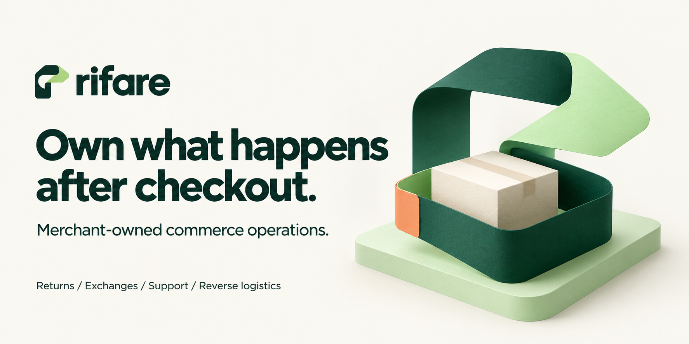

# Own what happens after checkout.

**Rifare brings returns, exchanges, order changes, support, and reverse logistics into a merchant-controlled commerce platform.** Tailor the workflow to your store, keep the business records, and choose how much help you want from agents and models.

[Try the local demos](#try-rifare) · [Explore the capabilities](#what-you-can-explore) · [See the design](#built-for-control-and-continuity) · [Project status](docs/PROJECT-STATUS.md)

> **Public development preview.** This checkout contains working TypeScript/Node.js and SQLite demonstrations with synthetic data. The production application, connected services, and target React/PostgreSQL stack remain unqualified. [What works today →](docs/PROJECT-STATUS.md)

## Commerce keeps going after the sale

A customer needs a different size. An order changes before it ships. A parcel arrives in pieces. A refund request times out, leaving someone to find out what actually happened.

Rifare is being built to keep those moments connected. The same case can carry its order facts, policy, approvals, and operation history through support, returns, exchanges, and follow-up. A change of agent or model should not mean starting over—or losing track of an action already in progress.

The design gives merchants three practical choices:

- **Make the workflow yours.** Versioned policies, reusable skills, and merchant profiles adapt the experience to your products and rules.
- **Keep people in control.** Staff can work without a model. Action previews, separate approvals, and current permission checks govern sensitive operations.
- **Keep your options open.** Platforms, adapters, agent runtimes, and model providers have separate responsibilities and replacement boundaries.

Read the [policy customization guide](docs/POLICY-CUSTOMIZATION.md), [support workflow](docs/SUPPORT-OPERATIONS.md), and [portability design](docs/SKILL-ARCHITECTURE.md) for the implementation and its limits.

## What you can explore

These are implemented local development paths. Their guides distinguish synthetic behavior, unsupported operations, and the evidence still needed for connected use.

| Workflow | What Rifare demonstrates | Explore |
| --- | --- | --- |
| **Returns and exchanges** | Per-item eligibility, original paid-value allocation, mixed refund/credit/exchange outcomes, and separate financial and fulfillment stages. | [Return resolution](docs/RETURN-RESOLUTION.md) · [Exchange depth](docs/exchange-depth.md) |
| **Order changes** | Preview address, variant, and cancellation changes; require approval; track payment and warehouse holds before release. | [Order editing](docs/ORDER-EDITING.md) |
| **Support and tracking** | Verified case context, individual shipment states, human takeover, and consent checks before a message is sent. | [Support operations](docs/SUPPORT-OPERATIONS.md) |
| **Shipping and inventory** | Package obligations, scan-to-pack sessions, location transfers, warehouse return events, and stock reconciliation. | [Packing](docs/PACKING-SESSIONS.md) · [Inventory](docs/INVENTORY-RECONCILIATION.md) |
| **Continuing customer journeys** | Durable references to earlier actions, shopper context, follow-ups, and loyalty quotes/redemption with their original operation identities. | [Journeys](docs/COMMERCE-JOURNEYS.md) · [Loyalty](docs/LOYALTY-REDEMPTION.md) |
| **Drop-off handoffs** | Site/method eligibility, controlled credential issuance, and item-level acceptance, rejection, corrections, and disputes. | [Drop-off guide](docs/DROPOFF-HANDOFFS.md) |

## Try Rifare

Start with a small commerce demonstration. It runs entirely in memory, uses synthetic orders, and needs no API key, model download, Docker, or external account.

**Prerequisites:** Git and Node.js **24.x**, or **22.16+ within 22.x**, with npm. The supported ranges are declared in [package.json](package.json).

```sh
git clone --branch development https://github.com/burdettadam/rifare.git
cd rifare
npm ci --offline --ignore-scripts
node --experimental-strip-types tools/demo-return-resolution.mts
```

The demo allocates one return across a refund, store credit, and an exchange quotation. It then simulates a refund response being lost and reconciles the original operation. Look for:

- `after_lost_response: "unknown"` followed by `after_lookup: "accepted"`.
- `send_attempts: 1`: the uncertain refund is not sent a second time.
- `external_calls: 0` and `production_qualified: false`.

The separate fixture settlement step is labeled in the output; it does not move real money. The exchange in this demo is a quotation, not a committed replacement order.

For an interactive support and shipment-tracking view:

```sh
node --experimental-strip-types tools/demo-support.mts --serve
```

Open the printed URL and follow the [local session instructions](docs/TRY-RIFARE.md#open-the-support-and-tracking-views). The guide also covers policy customization, recovery demonstrations, the basic smoke environment, and stopping each instance.

**Use these explicit demo commands.** `npm run dev` intentionally exits until the target application stack is qualified.

## Built for control and continuity

### The merchant keeps the business state

Cases, policy versions, previews, approvals, and receipts live in the commerce core. A provider's conversation thread is not the order ledger. [Commerce journeys](docs/COMMERCE-JOURNEYS.md) compose the existing records so a later interaction can reconnect to the original work.

### Suggestions and execution have separate responsibilities

Skills describe the work. Merchant profiles tailor it. Agents can propose actions. The [action gateway](packages/commerce/action-gateway.mts) checks current identity, policy, source facts, approval, and ownership before allowing an operation. Optional [decision models](docs/DECISION-MODELS.md) and [routing](docs/DECISION-ROUTING.md) build on that boundary; a model answer does not grant authority.

### Uncertainty is part of the workflow

A timeout can happen after a source accepts an operation. Rifare retains the original operation identity, records an unknown outcome, and reconciles before another effect is allowed. The [reliability demonstration](docs/OPERATION-RELIABILITY.md) makes that recovery behavior inspectable. A receipt distinguishes what was requested, accepted, and later observed.

### Portability includes recovery

[Merchant export/import](docs/MERCHANT-PORTABILITY.md), [privacy coverage](docs/PRIVACY-COVERAGE.md), and restored-environment controls are part of the design. Importing records does not reactivate their old execution authority. These are implemented diagnostic controls with documented limits, not compliance certifications.

## Where the project stands

The current development checkpoint reaches **M20-G03: item-level drop-off handoffs**. The source also contains local returns, support, shipping, inventory, customer-journey, and loyalty work. Milestone numbers describe development progress; they do not certify production readiness.

The next recorded commerce increment is consolidation and custody continuity. Connected-provider qualification, the target application stack, independent deployment, and formal acceptance remain open. Browser inference is adopted roadmap work, not an available download in this preview.

[Current status and evidence](docs/PROJECT-STATUS.md) · [Roadmap](ROADMAP.md) · [Detailed progress](PLANS.md)

## Find your way around

| If you want to… | Start here |
| --- | --- |
| Run the demos and understand their output | [Try Rifare](docs/TRY-RIFARE.md) |
| Understand the product's boundaries | [Current status](docs/PROJECT-STATUS.md) · [Compatibility limits](docs/COMPATIBILITY-LIMITS.md) |
| Inspect the engineering design | [Architecture](ARCHITECTURE.md) · [Skill architecture](docs/SKILL-ARCHITECTURE.md) |
| Continue an assigned development task | [Development](DEVELOPMENT.md) · [Agent instructions](AGENTS.md) · [Worker goals](WORKER-GOALS.md) |
| Review earlier decisions and milestones | [Decisions](docs/decisions/README.md) · [Work records](work/README.md) |

## License and project access

Rifare is a **public development preview**. The selected licensing direction is AGPL-3.0-only for the application and Apache-2.0 for separable SDKs, skills, and original developer documentation. License application and distribution review remain unfinished; this README does not grant those licenses. See [license status](LICENSE-STATUS.md), [licensing detail](docs/LICENSING.md), and [third-party notices](THIRD-PARTY-NOTICES.md).

**Star Rifare to follow its development.** [Browse the latest changes →](https://github.com/burdettadam/rifare/commits/development/)
