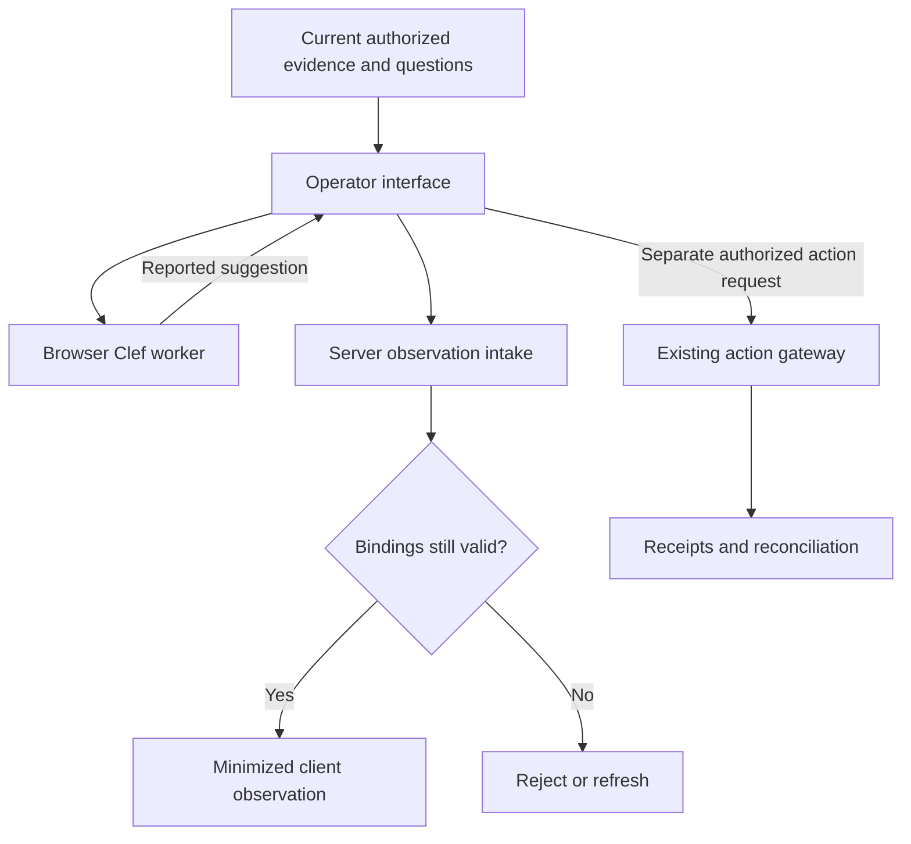

# Rifare architecture direction

**Target architecture with bounded local implementations through M14. Browser inference is adopted planning under ADR-0044; it is not implemented or qualified by this update.** The protected implementation is `Rifare-M14-calibrated-routing.zip`, main `93769a3029ebd2a5204c756733a8f8cf48fb67cd`. The current head, work records and exact candidate evidence determine progress. Formal target-stack, connected-service and milestone acceptance remain separate.

## Product and implementation foundations

Rifare is a merchant-owned commerce operations platform. Start with returns/exchanges, safe edits, support and tracking; expand after the relevant qualification. The core holds durable business state, money/inventory rules, policies, approvals and receipts. Human UI, rules, built-in and external agents share the same authority boundary.

Portable skills describe workflows. Typed merchant profiles customize permitted fields. Platform packs describe capabilities; adapters perform supported native operations. Model providers and agent runtimes remain independently replaceable. Keys stay in server-side integration boundaries, never skill text or provider-owned business records.

The intended target implementation remains a modular TypeScript/Node service and worker, React UI, PostgreSQL, durable jobs and attachment storage. The current diagnostic stack does not establish that target's qualification. Prefer narrow adapters and native tooling to new orchestration.

The action lifecycle is verified intent, current facts, policy evaluation, preview, required approval, current-state recheck, execution, receipt and reconciliation. Return authorization, physical movement, receipt/inspection, financial settlement and replacement fulfillment remain distinct.

Unknown remote outcomes retain their original durable operation identity and applicable reservations until authoritative reconciliation resolves them. A timeout, changed agent, expired local reservation or new request key cannot create permission to repeat an uncertain effect. Evidence, permissions, privacy, no-AI behavior, portability, compatibility and restore safety remain cumulative requirements.

Read [the roadmap](ROADMAP.md), [skill architecture](SKILL-ARCHITECTURE.md), [invariants](../planning/invariants.json), [capability targets](../planning/capability-targets.json) and [current progress](PLANS.md). Synthetic examples demonstrate shape, not qualified execution. Partners remain prerequisites for physical or regulated services.

## Current diagnostic and decision-model boundaries

`apps/api`, `apps/worker` and `apps/web` are separate owned local processes. Shared fixture persistence and lifecycle code is in `packages/development`. The original M00-G05 environment uses transactional SQLite fixture migrations and a web shell that is not React. [ADR-0006](decisions/0006-local-environment-qualification.md) preserves the PostgreSQL/React target and unperformed qualification.

M13-G01 through G05 retain bounded local outcomes: finite typed decision requests, published question resources, authorized evidence snapshots, an optional Workers AI reader, shadow observations and a frozen evaluation protocol. Its fixture evidence does not accept formal M13-G99 or actual model qualification. See [decision contracts](DECISION-MODELS.md), [shadow observations](DECISION-SHADOW.md), [M13 qualification](M13-QUALIFICATION.md) and [the M13 integration record](../work/records/M13-milestone-integration.md).

M14 adds frozen calibration and qualification intake, selected manual-work diagnostic routing, SystemOne transport, versioned activation, canaries, fallback and rollback. The reviewed local checkpoint records sixty selected passing development cases. Actual backend cohorts, two-backend portability, optional self-hosted observations and formal M14-G99 remain pending. See [routing contracts](DECISION-ROUTING.md), [M14 qualification](M14-QUALIFICATION.md) and [the M14 integration record](../work/records/M14-milestone-integration.md). M15–M25 are planning; this architecture adoption assigns no product implementation.

Browser work extends these interfaces. It does not rebuild the question, case, permission, budget, receipt, privacy or evaluation owners.

Reuse `packages/agent/decisions.mts`, `packages/commerce/decision-resources.mts`, `packages/commerce/decision-shadow.mts` and `packages/agent/decision-evaluation.mts` according to their actual contracts. At the protected M14 checkpoint, the executable shadow service accepts the two known server reader types: Workers AI and SystemOne. It retains server configuration, vault, budget and provenance checks; the original M13 observed-inference verifier remains scoped to its Workers AI evidence. Reuse M14's `packages/agent/systemone.mts`, `packages/agent/decision-calibration.mts` and `packages/commerce/decision-routing.mts` within those boundaries. A browser runner needs a new explicit observation path; preserve the current server paths and checks, and never invent a browser secret, fake provider usage or copy their branded receipts.

The current decision module also has Node-specific dependencies through commerce validation and request sizing. Extract the smallest browser-safe logical types and validation needed, preserving their behavior and server validation. Do not bundle the commerce kernel, Node storage modules or vault into the browser. The existing private preparation handles are process-local objects; the browser bridge needs a server-issued, scoped, expiring preparation identity with replay control, not serialization of those handles.

## Decision execution modes

The target design provides an explicit choice of execution location. The table separates existing bounded server/manual paths from future browser work. Availability and qualification belong to a complete configuration, not a model name alone.

| Mode | Execution location | Credentials and data destination | Initial role |
| --- | --- | --- | --- |
| Manual / rules | Existing Rifare core | Existing case and policy access | Always available |
| Hosted decision model | Approved remote provider, called by the server | Server vault; separately approved provider and purpose | Existing M13 shadow path; M14 owns measured routing |
| Merchant-controlled server | Approved SystemOne-compatible endpoint | Existing server integration and credential controls | M14-G04 endpoint and replacement work |
| Browser Clef Flash | Operator device, Kevala WebGPU with a WASM coordinator | Model assets from approved locations; no provider key in the browser | M23 text/JSON shadow suggestions |
| Compact browser backend | Operator device, qualified Wllama/GGUF build | Same browser data boundary; separately pinned runtime and quantization | M24 optional second implementation |
| Browser image assistance | Operator device with a qualified vision companion and decision path | Exact M17-authorized media versions and purpose | M25 after its media and runtime gates |

The first browser target is an opted-in desktop operator session. Smartphone, general shopper-page, CPU-only and all-browser support require their own scope and measurements. Browser-local processing sends no case content to an external inference provider. Model downloads and normal authorized Rifare API calls are separate network activities that must be described accurately.

A model-load failure preserves manual handling. Hosted fallback requires the separately permitted purpose/provider configuration and an explicit mode change. Local failure, timeout, missing WebGPU or missing assets never silently authorize evidence upload.

## Browser runtime and model packaging

### First implementation: Clef Flash through Kevala

The third-party runtime, revision and artifact observations below retain the 2026-10-19 handoff's research snapshot. They are planning inputs, not new upstream verification or Rifare execution evidence. The owning worker must check and pin the actual supported versions and artifacts before implementation or qualification.

The initial target is a pinned Clef-capable Kevala build running Clef Flash Q8 text/JSON on WebGPU. Kevala documents this decision path and a small upstream comparison, while its published npm release and ready-made pack catalog do not yet provide a complete Clef installation. The worker must pin/build the required runtime and produce or obtain a verified native-converted pack. Browser execution and browser conversion are separate capabilities. See [Kevala](https://github.com/bvolpato/kevala) and [pack conversion/loading](https://github.com/bvolpato/kevala/blob/main/docs/packs.md).

The computation must retain Clef's trained model semantics: tokenized evidence and questions, question/option spans and backbone representations, the joint decision head, lexical readout and typed probabilities. A generic Qwen chat model producing JSON is not a Clef implementation. The source model and custom head are described in the [Cloudflare Flash release](https://huggingface.co/Cloudflare/clef-flash).

Keep the existing `noul`, `choice` and `score` contracts. `noul` is the question type name and yields a probability of true; it is not JSON `null`. Preserve question IDs, complete option/level vocabularies, missing evidence and arithmetic validation. A different runtime's numerical format needs explicit normalization and recorded tolerances, not silent probability repair.

An approved browser execution profile records:

- Model and trained-head revisions, tokenizer/configuration and preprocessing identity.
- Runtime and converter commits, build options, precision, pack/shard sizes and digests, and applicable distribution notices.
- Effective question, option, byte and token limits; allowed modalities; configured model-asset destinations.
- The supported browser/OS/device/backend configuration, observed resource limits and qualification record.
- Cache identity, disposal behavior, update/rollback policy and the purpose for which the profile may be used.

Kevala's source catalog currently pins `Cloudflare/clef-flash` to `8b2e5fd17c09fd49bc2880b805d5323ec7ff4ff3`; that is a source reference, not a complete Rifare runtime pin. Record the actual converter/runtime and output manifest separately. [Source catalog](https://github.com/bvolpato/kevala/blob/main/tools/model-sources.json).

The loader runs away from the UI thread and provides download progress, cancellation, exact artifact verification, bounded initialization and a useful unavailable state. Streaming and shard handling must reject mixed revisions and incomplete downloads. An approved manifest supplies integrity expectations; matching a hash from the same untrusted payload establishes no independent trust.

### Resource envelope and smaller backend

Kevala estimates a Clef Flash Q8 pack at about 10.59 GB and states that inference needs additional memory. The first release therefore needs an explicit download/storage choice and an actual load/warmup check on a named desktop profile. Feature detection alone is insufficient. Record actual package size, load time, working memory, request latency and device-loss behavior; do not infer a minimum hardware specification from weight size. [Model and memory guide](https://github.com/bvolpato/kevala/blob/main/docs/models.md).

M24 evaluates the published Clef Flash Q4_K_M GGUF as a smaller artifact: the current listing is 6.49 GB, with Q8_0 at 9.66 GB. These are artifact sizes, not total RAM/VRAM requirements or evidence of browser compatibility. [Published Flash GGUF files](https://huggingface.co/ggml-org/Clef-Flash-GGUF/tree/main).

Use the maintained `ngxson/wllama` project. Verify and, where necessary, repair its complete Clef joint-request path in the pinned build before offering a second backend. Generic WebGPU, chat or SystemOne API availability does not establish that path's correctness. Preserve the original head and record quantization differences. Keep M14-G04's server endpoint work intact. [Wllama](https://github.com/ngxson/wllama) · [SystemOne wrapper](https://github.com/ngxson/wllama/blob/master/src/wllama.ts) · [upstream joint-request implementation](https://github.com/ggml-org/llama.cpp/blob/master/tools/server/server-decision.cpp).

## Data flow and authority

The server authorizes and minimizes the evidence package before release to the authenticated operator. Bind it to tenant, store, actor/session, case/task, source versions, published questions/profile, purpose, selected execution profile and a finite lifetime. Browser mode grants no additional data access. No provider key, merchant credential, privileged adapter handle or secret vault capability enters the model state or worker messages.

Browser outputs, scores, timings and claimed runtime identities are untrusted client submissions. Intake validates their strict schema, expected question vocabulary, current source/configuration bindings, authority, stop state and request identity. Server-verifiable facts and client-reported execution metadata remain distinguishable. A canonical receipt may attest that the server accepted a client observation under those checks; it cannot attest that the browser actually executed the approved model.

M13's v1 reader provenance and privately branded service observations remain protected. Browser ingestion uses an explicit new/versioned client-observation envelope around reused validators and receipt ownership. It must not relabel client data as `synthetic_wire_fixture`, `live_test_unqualified`, a trusted vault reader result or independently observed inference. Existing case schema and business records retain their owners; any justified observation-contract extension is additive and versioned.

An altered or replayed browser result cannot establish eligibility, approve a preview, spend money, move stock, publish policy, send a message or independently activate M14 routing. An operator can review a suggestion and make a separately authorized request through the ordinary workflow. A future automatic route needs server-enforced trustworthy decision inputs as well as M14 qualification; browser calibration or artifact hashes alone are insufficient.

Use original request identities for observations and original operation identities for business effects. Enforce current authorization on replay and fence late results after evidence changes, erasure, takeover, cancellation, session/tenant changes or configuration revocation. New inference creates a new observation without rewriting prior approvals or receipts.

## Browser privacy, storage and failure handling

Public model assets may use a bounded, versioned cache. Case text, media, prompts, intermediate tensors, outputs and credentials stay out of persistent model caches by default. Explicit cache code must exclude protected API responses; response headers alone are not the application's cache policy. Any later persistence of customer content must first extend the existing privacy inventory, purpose, tenant separation, export, correction, retention, erasure and restore behavior.

Storage quota and eviction behavior must be handled by the loader, and any persistence request remains visible in the device capability record. [Browser storage behavior](https://developer.mozilla.org/en-US/docs/Web/API/Storage_API/Storage_quotas_and_eviction_criteria) · [Cache API semantics](https://developer.mozilla.org/en-US/docs/Web/API/Cache).

Dispose of task state on cancellation, logout and tenant switching, and reject late completions at the server. Document the actual cleanup boundary: an application cannot promise forensic deletion or retroactively revoke bytes already obtained by an operator-controlled device. Avoid duplicate task copies in telemetry, crash reports, browser logs and service-worker caches.

Use a secure deployment and an appropriate content-security policy for the operator surface and approved asset destinations. Qualify any cross-origin-isolation/threading headers with the actual sign-in and popup/resource flows. A Web Worker provides execution separation for responsiveness; it does not make browser code a trusted server or prove network confinement. Failure handling covers insufficient quota, eviction, oversized inputs, partial assets, shader/init errors, GPU allocation failure, device loss, timeout and tab closure.

The declared browser profile must satisfy its actual [WebGPU requirements](https://developer.mozilla.org/en-US/docs/Web/API/WebGPU_API) and any [cross-origin-isolation requirements](https://developer.mozilla.org/en-US/docs/Web/API/Window/crossOriginIsolated) of the selected threading build.

Offline inference is limited to temporary suggestions over already authorized input with a locally enforced expiry. It cannot obtain current facts, renew permissions, commit a canonical receipt, queue a commerce effect or bypass server checks. Reconnection requires authentication and freshness rechecks; stale observations are discarded or recomputed. Offline inference is separately qualified and remains disabled until that behavior is demonstrated.

## Browser media extension

M23 is text/JSON only. Kevala's Clef path currently excludes images, and Wllama's SystemOne wrapper also documents image input as unsupported. Generic model or chat vision support does not qualify a decision-media path. [Kevala model guide](https://github.com/bvolpato/kevala/blob/main/docs/models.md) · [Wllama decision API](https://github.com/ngxson/wllama/blob/master/src/wllama.ts).

M25 adds images only after the relevant M17 intake, quarantine/processing, exact-version access and privacy requirements are met. A compatible vision companion, bounded preprocessing, exact image/question alignment and the complete decision API must be implemented and independently observed. Browser-local media approval is purpose-specific and does not authorize hosted upload. Audio/video remain separate M17 scope and are not enabled by browser text or image qualification.

Local image output can assist an operator with evidence usability or visible detail. It cannot establish identity, authenticity, fraud, warranty entitlement, physical receipt or financial authority. Invalid, ambiguous or unsupported evidence retains a cannot-assess/manual path.

## Milestone ownership and sequence

M00–M12 retain the original commerce, shipping, growth, partner, inventory and extension foundations. M12-G08/G09 continue to own the need assessment and conditional generated-code path; browser model inference does not enable code mode or remove its deferral.

| Milestone | Architectural responsibility | Browser relationship |
| --- | --- | --- |
| M13 | Shared decision contracts, evidence and shadow observations | Reuse the existing local implementation; preserve server provenance |
| M14 | Calibration, bounded routing and backend replacement | Qualify each execution profile separately; retain the server endpoint and trusted routing boundary |
| M15 | Sender-bound remote agent access | Browser inference does not grant remote-agent credentials or exemptions |
| M16 | Managed execution restrictions | Browser execution is a different boundary from managed server isolation |
| M17 | Multimodal intake, privacy and measured assistance | Owns all media prerequisites reused by M25 |
| M18 | Persistent commerce journeys | May consume reviewed observations under existing purpose and continuity rules |
| M19 | Return-aware loyalty | Points, reservations and financial authority remain in the core |
| M20 | Qualified QR drop-off | Partner custody and receipt evidence remain independent of model output |
| M21 | Warehouse routes, waves and supplies | Routing, inventory and procurement owners retain authority |
| M22 | Individualized campaigns | Existing approval, consent and send owners remain authoritative |
| M23 | Browser Clef Flash through pinned Kevala Q8 | First browser text/JSON implementation and named desktop qualification |
| M24 | Compact browser backend and comparison | Wllama joint-path verification/repair, Q4 GGUF and measured replacement |
| M25 | Browser image evidence assistance | Qualified vision companion and decision API over the M17 media path |

M23–M25 add fifteen bounded worker goals and three G99 assessments. M23 builds on M13. M24 builds on M23 and the relevant M14 calibration/compatibility controls. M25 builds on M23 and M17; it may use an independently qualified image backend without making M24 mandatory. Full goal contracts, dependencies, proposed implementation paths and acceptance behavior are adopted in [the worker catalogue](../planning/WORKER-GOALS.md), [canonical goals](../planning/goals.json) and [the browser worker handoff](BROWSER-WORKER-HANDOFF.md).

Adoption uses a second frozen additive requirement document. Preserve the existing `planning/reference/additions/m13-m22-requirements.json` and its protected digest, then extend the planner's exact required union with the newly approved browser requirements. Update canonical roadmap, goals, specifications, coverage and generated views together. The current plan already contains M00–M22; the earlier research ZIP's M08 baseline and instruction to implement M13 next are historical, not restoration or reassignment instructions.

The recommended next browser batch is M23-G01 through G05: pin and reproduce the model path, build bounded loading, integrate client observations, complete privacy/fallback handling, and observe a real desktop demonstration. M14's local implementation is retained; its actual backend measurement and external qualification remain pending. M15 is still the earliest unassigned goal in the existing numerical sequence. The browser recommendation is separate from the historical initial queue and does not skip or accept other goals. All new goals remain unassigned after this planning update. Formal dependencies remain open until accepted; a later bounded local preparation assignment cannot waive them.

## Qualification and development policy

Keep four distinct evidence levels: contract/fixture behavior; actual inference and conversion fidelity; representative task quality/calibration; and release qualification for a declared deployment. Upstream reported results, our research, a loaded model name or a settings switch cannot replace any required Rifare observation.

Before comparing a browser build, freeze the reference revisions, questions and exact option order, evidence/tokenization/spans, corpus roles, probability/decision tolerances, numerical rounding, performance targets and allowed exclusions. Retain unfavorable and unavailable results. Compare actual implementations on the same task, and recalibrate materially changed model, precision, runtime, preprocessing and question profiles. Deterministic business rules do not imply numerically identical model probabilities across devices.

Use the existing focused development policy: at most 60 actual cases across four whole files and one 60-second invocation by default, once per coherent batch. Model downloads/conversion and long-running browser qualification are explicit separate work with recorded resources and scope. They are not triggered by every edit. Documentation/planning changes need targeted document and reference checks; no application regression or model inference is required merely to adopt this update. Formal integration/release gates and original test IDs, oracles and acceptance criteria remain intact.
