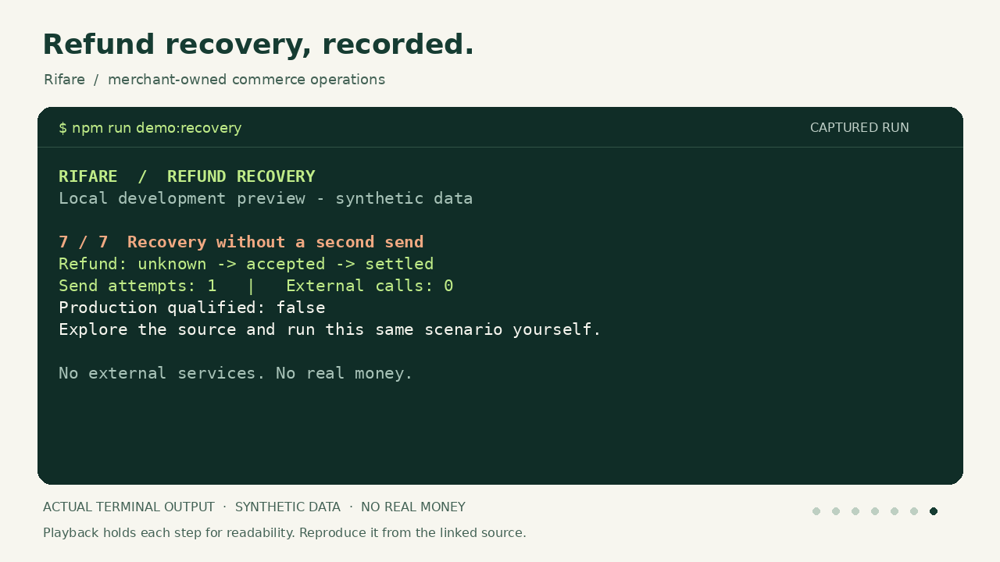

# Recorded refund recovery

This is a recording of the running local synthetic implementation. It shows a
refund being accepted by its fixture source, a lost response, a repeated dispatch
that retains the original uncertain operation, and a read-only lookup that finds
the original result. A later fixture settlement is explicitly observed separately.

[Watch the 28-second MP4](refund-recovery.mp4) ·
[Animated preview](refund-recovery.gif) ·
[Read the complete transcript](refund-recovery.txt) ·
[Original terminal capture](refund-recovery.cast)



## Reproduce the scenario

Use the [supported Node version and checkout setup](../TRY-RIFARE.md):

```sh
npm ci --offline --ignore-scripts
npm run demo:recovery
```

The guided mode narrates the same runtime operations as `npm run demo:returns`.
Each scene is emitted after its corresponding operation and assertions complete.
The default command still produces one JSON result. The guided mode adds only
presentation output and pauses. `npm run check:preview` verifies the returns and
support JSON demonstrations with the retained network-denial hook.

## Recording provenance

The capture ran from a clean checkout of
`b7102d3ffc121326a8475062eef9878c9b157893`, using Node.js 24.19.0. It exited with code 0.
The full command, time, source tree, demo-file digest, and media hashes are in
[manifest.json](manifest.json). Its recorded runtime source is unchanged in this
presentation follow-up. Later license, documentation, and inventory commits do
not change the demonstrated behavior.

The `.cast` file is an asciinema-v2-compatible record of actual pseudo-terminal
output and original event timings. The plain-text transcript preserves every
scene. The GIF and MP4 render those same seven completed screens in Rifare's
colors, holding each for four seconds so they can be read. The original run took
about 18 seconds, including its intentional presentation pauses. The video contains
no audio, generated product imagery, or invented output. It is a narrated terminal
replay, not a browser screenshot or a performance benchmark.

The capture/render helpers are included with the Codex handoff for regenerating
these presentation assets. They use Python, Pillow, FFmpeg, and host DejaVu fonts;
no font or renderer binaries are bundled with the source.

## What this proves

The local fixture accepts the original refund; a lost response leaves Rifare's
state `unknown`. Repeating dispatch retains that identity and keeps the send
count at 1. Reconciliation moves the same operation to `accepted`; advancing the
fixture and observing it again moves it to `settled`. The exchange remains an
uncommitted quotation and reserves no stock.

This run makes zero external calls and moves no real money. It does not establish
payment-provider, merchant, carrier, production, or target-stack qualification.
See [project status](../PROJECT-STATUS.md) and
[operation reliability](../OPERATION-RELIABILITY.md) for those boundaries.
